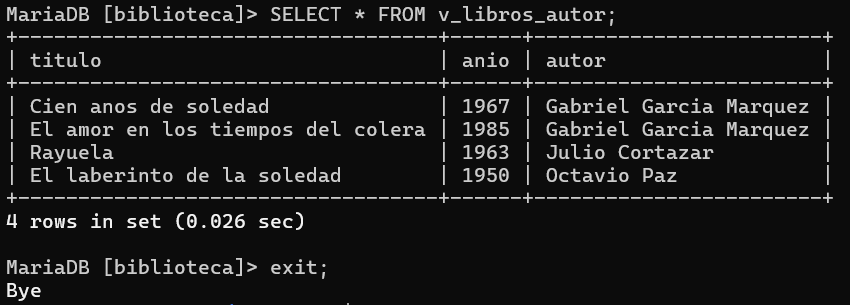
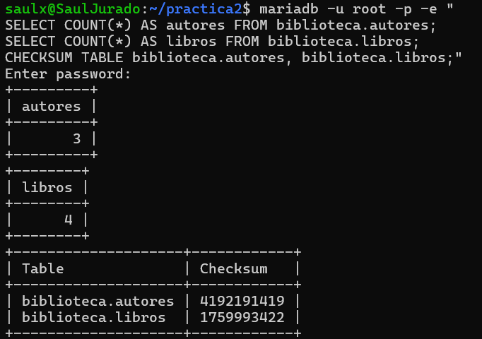
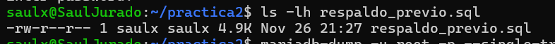
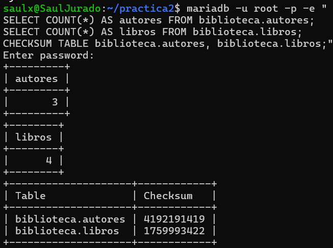
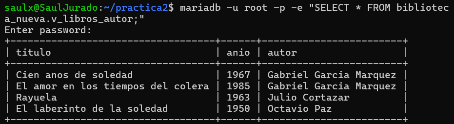
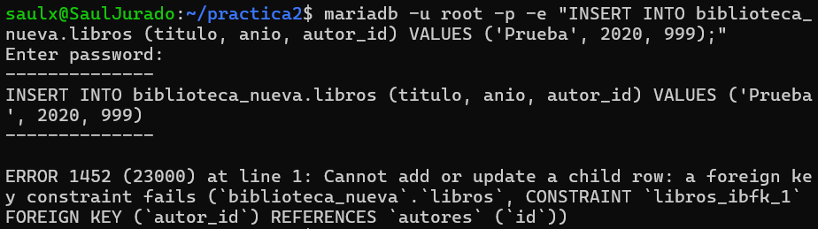
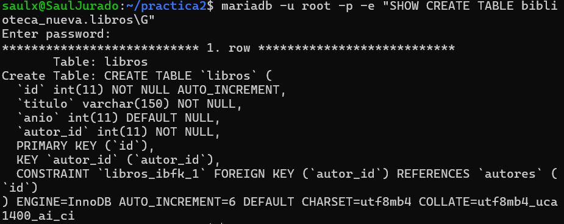

# Instituto Tecnologico Nacional de México
# ITMA II
## Administración de Bases de Datos

# Práctica 2: Migración de una Base de Datos en MariaDB

**Alumno:** Saúl Jurado Noriega
**Materia:** Administración de Bases de Datos
**Profesor:** Diego Alberto Bollas Paredes  
**Práctica:** Migración de una base de datos en MariaDB  
**Fecha:** 26 de noviembre de 2026

---

# Introducción

La migración de bases de datos es un procedimiento utilizado para trasladar información, estructuras y objetos de una base de datos hacia otra ubicación manteniendo la integridad de los datos. Durante esta práctica se realizó la migración de la base de datos `biblioteca` hacia una nueva base llamada `biblioteca_nueva` utilizando únicamente herramientas de MariaDB desde la terminal Linux.

Además de realizar la migración, se ejecutaron diferentes pruebas para validar que los datos, estructura, vistas y restricciones fueron transferidos correctamente.

---

# Desarrollo

## Paso 1. Creación de la base de datos origen

Se ingresó al servidor MariaDB como usuario administrador.

```bash
mariadb -u root -p
```

Creación de la base de datos:

```sql
CREATE DATABASE biblioteca;
USE biblioteca;
```

Creación de las tablas e inserción de registros según el procedimiento de la práctica.

Creación de la vista:

```sql
CREATE VIEW v_libros_autor AS
SELECT l.titulo, l.anio, a.nombre AS autor
FROM libros l
JOIN autores a ON a.id = l.autor_id;
```

Verificación:

```sql
SELECT * FROM v_libros_autor;
```

### Evidencia

**Vista creada correctamente mostrando los libros y autores registrados.**



---

## Paso 2. Registro de información del origen

Se ejecutó:

```bash
mariadb -u root -p -e "
SELECT COUNT(*) AS autores FROM biblioteca.autores;
SELECT COUNT(*) AS libros FROM biblioteca.libros;
CHECKSUM TABLE biblioteca.autores, biblioteca.libros;"
```

### Resultado obtenido

| Elemento | Valor |
|-----------|---------|
| Autores | 3 |
| Libros | 4 |
| Checksum autores | 4192191419 |
| Checksum libros | 1759993422 |

### Evidencia

**Conteo de registros y checksum obtenidos de la base de datos origen.**



---

## Paso 3. Respaldo de seguridad

Antes de comenzar la migración se generó una copia de seguridad.

```bash
mariadb-dump -u root -p --databases biblioteca > respaldo_previo.sql
```

Verificación:

```bash
ls -lh respaldo_previo.sql
```

### Resultado obtenido

Archivo generado exitosamente:

```text
respaldo_previo.sql
```

Tamaño aproximado:

```text
4.9 KB
```

### Evidencia

**Comprobación de la creación correcta del respaldo previo a la migración.**



---

## Paso 4. Exportación de la base de datos

```bash
mariadb-dump -u root -p --single-transaction --routines --triggers --events biblioteca > biblioteca_migracion.sql
```

### Descripción

- `--single-transaction` genera una copia consistente.
- `--routines` exporta procedimientos y funciones.
- `--triggers` exporta disparadores.
- `--events` exporta eventos programados.

---

## Paso 5. Creación de la base destino

```bash
mariadb -u root -p -e "CREATE DATABASE biblioteca_nueva;"
```

### Resultado

La base de datos destino fue creada correctamente.

---

## Paso 6. Importación en la base destino

```bash
mariadb -u root -p biblioteca_nueva < biblioteca_migracion.sql
```

### Resultado

La importación concluyó sin errores.

---

## Paso 7. Validación de la migración

### Comparación de conteos y checksum

```bash
mariadb -u root -p -e "
SELECT COUNT(*) AS autores FROM biblioteca_nueva.autores;
SELECT COUNT(*) AS libros FROM biblioteca_nueva.libros;
CHECKSUM TABLE biblioteca_nueva.autores, biblioteca_nueva.libros;"
```

### Evidencia

**Verificación de que los datos migrados coinciden con la base original.**



---

### Verificación de la vista

```bash
mariadb -u root -p -e "SELECT * FROM biblioteca_nueva.v_libros_autor;"
```

### Evidencia

**La vista migrada funciona correctamente.**



---

### Verificación de integridad referencial

```bash
mariadb -u root -p -e "
INSERT INTO biblioteca_nueva.libros
(titulo, anio, autor_id)
VALUES ('Prueba',2020,999);"
```

Resultado esperado:

```text
ERROR 1452 (23000)
```

### Evidencia

**Comprobación de la restricción de clave foránea después de la migración.**



---

### Verificación de estructura

```bash
mariadb -u root -p -e "SHOW CREATE TABLE biblioteca_nueva.libros\G"
```

### Evidencia

**Estructura de la tabla restaurada correctamente.**



---

## Tabla de Validación

| Comprobación | Origen | Destino | ¿Coincide? |
|-------------|---------|---------|------------|
| Filas en autores | 3 | 3 | Sí |
| Filas en libros | 4 | 4 | Sí |
| Checksum autores | 4192191419 | 4192191419 | Sí |
| Checksum librospráctica se llevó a cabo la migración completa de una base de datos MariaDB utilizando herramientas nativas de línea de comandos. Posteriormente se realizaron pruebas de validación mediante conteos de registros, checksums, vistas e integridad referencial.

Los resultados obtenidos confirmaron que la migración fue exitosa, ya que no existieron pérdidas de información ni modificaciones en la estructura de la base de datos. Además, se comprobó la importancia de generar respaldos antes de cualquier procedimiento de migración para garantizar la recuperación de la información ante posibles fallos.

# Cuestionario - Práctica 2

## 1. ¿Por qué se hace un respaldo antes de migrar?

Porque durante una migración pueden ocurrir errores humanos, fallos de hardware o problemas de software que provoquen pérdida o corrupción de datos. El respaldo permite restaurar la información original en caso de cualquier incidente.

---

## 2. ¿Para qué sirve la opción --single-transaction?

Permite realizar la exportación dentro de una única transacción consistente. Esto evita inconsistencias en bases de datos que continúan recibiendo modificaciones mientras se genera el respaldo.

---

## 3. ¿Qué diferencia hay entre exportar con y sin --databases?

Con `--databases`, el archivo generado incluye instrucciones para crear y seleccionar la base de datos original mediante los comandos `CREATE DATABASE` y `USE`.

Sin `--databases`, únicamente se exportan las tablas, vistas y datos, permitiendo restaurarlos en una base de datos con un nombre diferente.

---

## 4. ¿Qué dos pruebas permiten confirmar que los datos migraron sin pérdidas?

1. Comparar la cantidad de registros mediante `COUNT(*)`.
2. Comparar los valores obtenidos con `CHECKSUM TABLE`.

Si los conteos y checksums coinciden, los datos fueron migrados correctamente.

---

## 5. Si el destino estuviera en otro servidor, ¿qué paso adicional sería necesario?

Sería necesario transferir el archivo de respaldo `.sql` al servidor destino utilizando herramientas como `scp`, `rsync`, FTP o cualquier otro método de transferencia de archivos antes de realizar la importación.

# Anexo de Investigación

## MariaDB

MariaDB es un sistema de gestión de bases de datos relacional de código abierto derivado de MySQL. Es ampliamente utilizado para almacenar, consultar y administrar información estructurada.

---

## MariaDB Dump

`mariadb-dump` es una herramienta de respaldo que genera archivos SQL con la estructura y los datos de una base de datos.

Ejemplo:

```bash
mariadb-dump -u root -p biblioteca > respaldo.sql
```

---

## Checksum

Un checksum es un valor numérico calculado a partir de los datos almacenados en una tabla.

Se utiliza para verificar que dos conjuntos de datos son idénticos.

Ejemplo:

```sql
CHECKSUM TABLE biblioteca.autores;
```

---

## Clave Foránea (Foreign Key)

Es una restricción que garantiza la integridad referencial entre tablas.

Permite asegurar que un registro relacionado exista previamente en otra tabla.

Ejemplo:

```sql
FOREIGN KEY (autor_id) REFERENCES autores(id)
```

---

## Vista (View)

Una vista es una consulta almacenada que puede utilizarse como una tabla virtual.

Ejemplo:

```sql
CREATE VIEW v_libros_autor AS
SELECT *
FROM libros;
```

---

## Integridad Referencial

Mecanismo que mantiene la coherencia de los datos relacionados entre tablas.

Impide insertar valores inexistentes en columnas que dependen de otra tabla.

---

## Opción --single-transaction

Genera un respaldo consistente utilizando una transacción única.

Es especialmente útil cuando la base de datos continúa operando mientras se genera el respaldo.

---

## Trigger

Objeto de base de datos que ejecuta automáticamente acciones cuando ocurre un evento específico.

Por ejemplo:

- INSERT
- UPDATE
- DELETE

---

## Event

Tarea programada que se ejecuta automáticamente en una fecha y hora determinadas dentro de MariaDB.

---

## Routine

Incluye procedimientos almacenados y funciones que pueden reutilizarse para automatizar operaciones en la base de datos.

---

## Migración de Bases de Datos

Proceso mediante el cual una base de datos es trasladada de un entorno hacia otro conservando estructura, datos y objetos asociados.

Los objetivos principales son:

- Actualización de infraestructura.
- Respaldo y recuperación.
- Consolidación de sistemas.
- Cambio de servidor.

https://github.com/saulx10a/practicaRecuperacion.git