# Tecnológico Nacional de México
# ITMA II

# Administración de Bases de Datos
# Práctica 1: Recuperación de una Base de Datos en MariaDB

**Alumno:** Saúl Jurado Noriega 
**Grupo:** 5SISC  
**Profesor:** Diego Alberto Bollas Paredes  
**Fecha:** 26 de noviembre del 2026  

---

# Introducción

La recuperación de bases de datos es un proceso fundamental para garantizar la disponibilidad e integridad de la información almacenada en un sistema gestor de bases de datos. Los errores humanos, fallos de hardware, problemas de software o interrupciones inesperadas pueden provocar la pérdida de información, por lo que resulta indispensable contar con mecanismos que permitan restaurar los datos de manera segura y eficiente.

En esta práctica se realizaron diferentes procedimientos de respaldo y recuperación utilizando MariaDB. En la primera parte se generó un respaldo lógico mediante la herramienta `mariadb-dump`, posteriormente se simuló la pérdida de una base de datos y se restauró exitosamente. En la segunda parte se empleó el Binary Log (binlog) para realizar una recuperación a un punto específico en el tiempo (Point-In-Time Recovery, PITR), permitiendo recuperar información generada después del respaldo y antes de un error provocado intencionalmente.

---

# Desarrollo

## Parte A. Respaldo y restauración de una base de datos

### Paso 1. Creación de la base de datos

Se ingresó al monitor de MariaDB utilizando la cuenta administrativa.

```sql
mariadb -u root -p
```

Se creó una base de datos llamada `tienda` y una tabla denominada `clientes`.

```sql
CREATE DATABASE tienda;
USE tienda;

CREATE TABLE clientes (
    id INT AUTO_INCREMENT PRIMARY KEY,
    nombre VARCHAR(100),
    email VARCHAR(100)
);
```

Posteriormente se insertaron cinco registros de prueba.

```sql
INSERT INTO clientes (nombre, email) VALUES
('Ana Torres', 'ana@correo.com'),
('Luis Perez', 'luis@correo.com'),
('Maria Gomez', 'maria@correo.com'),
('Carlos Ruiz', 'carlos@correo.com'),
('Sofia Diaz', 'sofia@correo.com');
```

Se verificó la cantidad de registros almacenados.

```sql
SELECT COUNT(*) FROM clientes;
```

Resultado obtenido:

```text
COUNT(*)
5
```

### Evidencia

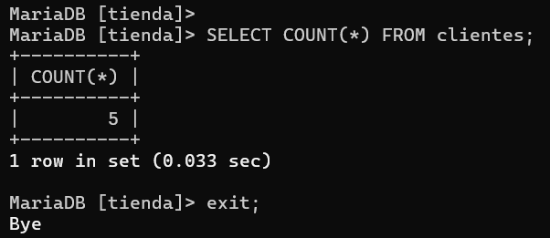

---

### Paso 2. Generación del respaldo lógico

Se creó un respaldo de la base de datos utilizando `mariadb-dump`.

```bash
mariadb-dump -u root -p --databases tienda > tienda_backup.sql
```

Posteriormente se verificó la existencia del archivo generado.

```bash
ls -lh tienda_backup.sql
```

Resultado:

```text
-rw-r--r-- 1 saulx saulx 2.5K tienda_backup.sql
```

### Evidencia

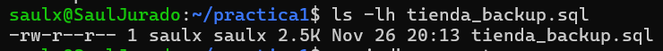

---

### Paso 3. Simulación de desastre

Se eliminó completamente la base de datos para simular una pérdida accidental de información.

```sql
DROP DATABASE tienda;
```

Posteriormente se verificó que la base ya no existiera.

```sql
SHOW DATABASES;
```

### Evidencia

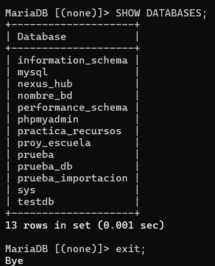

---

### Paso 4. Restauración del respaldo

Se recuperó la base de datos utilizando el archivo SQL generado previamente.

```bash
mariadb -u root -p < tienda_backup.sql
```

### Evidencia

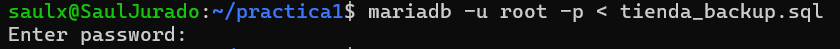

---

### Paso 5. Verificación de la recuperación

Se comprobó que la información hubiera sido restaurada correctamente.

```bash
mariadb -u root -p -e "SELECT * FROM tienda.clientes;"
```

Resultado obtenido:

```text
Ana Torres
Luis Perez
Maria Gomez
Carlos Ruiz
Sofia Diaz
```

### Evidencia

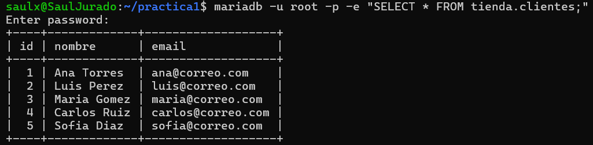

---

# Parte B. Recuperación mediante Binary Log (PITR)

## Paso 1. Activación del Binary Log

Se editó el archivo de configuración de MariaDB.

```bash
sudo nano /etc/mysql/mariadb.conf.d/50-server.cnf
```

Se verificó que el registro binario estuviera habilitado.

```bash
mariadb -u root -p -e "SHOW VARIABLES LIKE 'log_bin';"
```

Resultado:

```text
log_bin = ON
```

### Evidencia

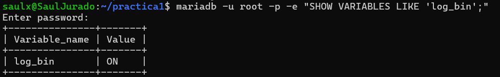

---

## Paso 2. Generación de respaldo para PITR

Se creó un respaldo especial que almacena la posición del binlog.

```bash
mariadb-dump -u root -p --databases tienda --flush-logs --master-data=2 > tienda_pitr.sql
```

Posteriormente se consultó la posición inicial almacenada.

```bash
grep "CHANGE MASTER" tienda_pitr.sql
```

Resultado obtenido:

```text
CHANGE MASTER TO
MASTER_LOG_FILE='mariadb-bin.000029',
MASTER_LOG_POS=389;
```

### Evidencia

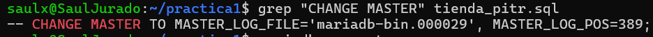

---

## Paso 3. Inserción de nuevos registros

Se agregaron dos nuevos clientes después de haber realizado el respaldo.

```sql
USE tienda;

INSERT INTO clientes (nombre, email) VALUES
('Pedro Nunez', 'pedro@correo.com'),
('Laura Vega', 'laura@correo.com');
```

Se verificó el total de registros.

```sql
SELECT COUNT(*) FROM clientes;
```

Resultado:

*``text
7 registros
```

Se registr* la hora del sistema.

```sql
SELE*T NOW();
```

Resultado:

```text
*026-11-26 20:17:53
```

*## Evidencia

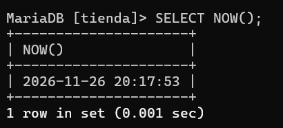

---

## Paso 4. Simulación*del error

Se ejecutó una eliminac*ón masiva de registros.

```sql
DELETE FROM clientes;
```

Posteriormente se verificó que la tabla quedara vacía.

```sql
SELECT COUNT(*) FROM clientes;
```

Resultado:

```text
0 registros
```

### Evidencia

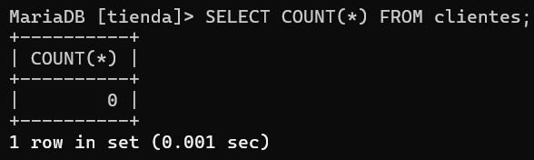

---

## Paso 5. Restauración del respaldo PITR

Se restauró nuevamente el respaldo especial.

```bash
mariadb -u root -p < tienda_pitr.sql
```

En este punto únicamente se recuperan los cinco registros originales.

### Evidencia

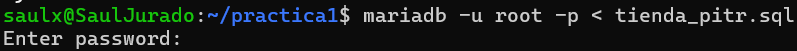

---

## Paso 6. Identificación del Binary Log

Se determinó la ubicación real de los archivos binarios.

```bash
mariadb -u root -p -e "SHOW VARIABLES LIKE 'log_bin_basename';"
```

Resultado:

```text
/var/lib/mariadb/mariadb-bin
```

Posteriormente se listaron los archivos disponibles.

```bash
sudo ls -lh /var/lib/mariadb/
```

Se confirmó la existencia del archivo:

```text
mariadb-bin.000029
```

### Evidencia

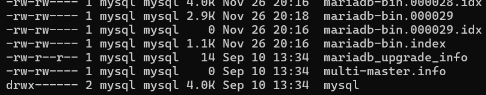

---

## Paso 7. Recuperación a un punto en el tiempo

Utilizando el archivo del binlog y la posición registrada durante el respaldo se realizó la recuperación hasta el momento previo al error.

```bash
sudo mariadb-binlog \
--start-position=389 \
--stop-datetime="2026-11-26 20:17:52" \
/var/lib/mariadb/mariadb-bin.000029 | mariadb -u root -p
```

Con este procedimiento se reaplicaron únicamente los cambios válidos posteriores al respaldo, excluyendo la eliminación accidental.

### Evidencia

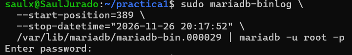

---

## Paso 8. Verificación final

Se comprobó la recuperación de todos los registros.

```bash
mariadb -u root -p -e "SELECT * FROM tienda.clientes;"
```

Resultado esperado:

```text
Ana Torres
Luis Perez
Maria Gomez
Carlos Ruiz
Sofia Diaz
Pedro Nunez
Laura Vega
```

### Evidencia

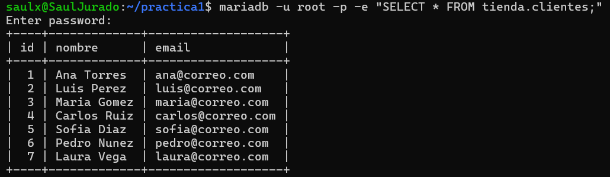

---

# Conclusiones

Durante esta práctica se comprendió la importancia de contar con mecanismos de respaldo y recuperación en los sistemas gestores de bases de datos. El uso de `mariadb-dump` permitió crear copias de seguridad lógicas capaces de restaurar completamente una base de datos después de su eliminación accidental.

Asimismo, se observó que un respaldo tradicional no puede recuperar información generada después de su creación. Por ello, la utilización del Binary Log resultó fundamental para implementar una recuperación a un punto específico en el tiempo (PITR), posibilitando restaurar registros agregados posteriormente y evitar la pérdida de información causada por errores humanos.

Finalmente, se comprobó que una estrategia adecuada de respaldos junto con los archivos binarios proporciona un mecanismo robusto para proteger la información crítica almacenada en MariaDB.

# Cuestionario - Práctica de Recuperación en MariaDB

## 1. ¿Qué datos se habrían perdido si solo hubieras usado el respaldo de la Parte A?

Se habrían perdido todos los cambios realizados después de la creación del respaldo. En esta práctica específicamente se habrían perdido los registros correspondientes a Pedro Nunez y Laura Vega, ya que fueron agregados posteriormente al respaldo original.

---

## 2. ¿Para qué sirve la opción --master-data=2?

La opción `--master-data=2` permite almacenar dentro del archivo de respaldo la información referente al archivo binlog y la posición exacta donde se encontraba el servidor al momento de generar el respaldo. Esta información es fundamental para realizar procesos de recuperación a un punto específico en el tiempo (PITR).

---

## 3. ¿Por qué es necesario activar el binlog antes de que ocurra el error?

Porque el Binary Log únicamente registra los eventos que ocurren mientras está habilitado. Si el binlog no se encuentra activo antes del incidente, los cambios realizados no quedarán registrados y será imposible reconstruir la secuencia de operaciones necesarias para recuperar la información perdida.

---

## 4. ¿Por qué se esperaron 5 segundos antes y después de anotar la hora?

La espera permite diferenciar claramente en el binlog los eventos válidos de los eventos que provocan el error. De esta manera es posible identificar un instante de tiempo preciso para detener la recuperación antes de ejecutar la operación incorrecta, evitando que el error vuelva a aplicarse durante el proceso de restauración.
